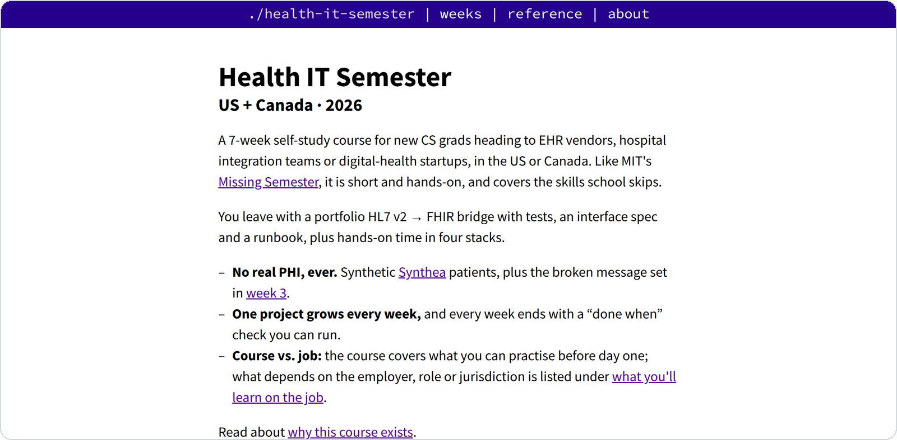

<div align="center">

# Health IT Semester

**The semester your CS degree skipped, for health tech.**

Seven hands-on weeks of HL7 v2, FHIR, clinical data, privacy and shipping,<br>
for new grads joining healthcare IT in the US and Canada.

[**Start the course →**](https://heyitworked.github.io/health-it-semester/)
&nbsp;·&nbsp; [Syllabus](#syllabus)
&nbsp;·&nbsp; [Lab setup](https://heyitworked.github.io/health-it-semester/lab-setup.html)
&nbsp;·&nbsp; [License](#license)

[](https://heyitworked.github.io/health-it-semester/)


[](#license)

<br>

<picture>
  <source media="(prefers-color-scheme: dark)" srcset=".github/assets/preview-dark.png">
  
</picture>

</div>

## Why this course

Computer science programs teach algorithms, systems and machine learning. They rarely teach how a hospital admits a patient, why a duplicate record is a safety problem, or what an HL7 acknowledgment actually promises. New grads learn those on the job, the hard way. This course is the missing semester for that job, in the format of MIT's [The Missing Semester of Your CS Education](https://missing.csail.mit.edu/).

- **Every command really ran.** 100 terminal sessions captured against a real lab (HAPI FHIR, Open Integration Engine, PostgreSQL, the HL7 FHIR validator and Synthea), with the output pasted verbatim.
- **One project that grows each week**, into a portfolio HL7 v2 → FHIR bridge with tests, an interface spec and a runbook.
- **US and Canada side by side**: HIPAA and PHIPA, US Core and CA Baseline, facility MRNs and provincial health card numbers.
- **Safe by default**: synthetic patients only, a PHI canary test, an audit log, and rules for AI coding tools.
- **Findings you won't get from the specs**: `mllp_send` exits 0 when no acknowledgment comes back, HAPI's access log records the MRN from every conditional update, and an engine's automatic AA can mean "received", not "delivered".

## Syllabus

| Week | Topic | You build | In the lab |
|:---:|---|---|---|
| | [Course overview](https://heyitworked.github.io/health-it-semester/overview.html) | Prework (~4 h): Docker, JDK 17+, Python 3, Node 20, .NET 8 SDK | |
| 0 | [Stack short runs](https://heyitworked.github.io/health-it-semester/week-0.html) | One FHIR kata in Java, C#, Python and TypeScript | Search, `$validate` and conditional PUT against HAPI FHIR |
| 1 | [How care works](https://heyitworked.github.io/health-it-semester/week-1.html) | A nurse's-eye account of one encounter; a glossary | Trace a synthetic ED visit through FHIR with jq |
| 2 | [Data + SQL](https://heyitworked.github.io/health-it-semester/week-2.html) | Five clinical questions in SQL and jq | Explain every count where SQL and FHIR disagree |
| 3 | [HL7 v2 + patient identity](https://heyitworked.github.io/health-it-semester/week-3.html) | An MLLP listener that upserts FHIR Patients | ACK only after the write; a broken-message test set |
| 4 | [FHIR APIs](https://heyitworked.github.io/health-it-semester/week-4.html) | Profile validation in CI; a SMART app | US Core and CA Baseline validation, bulk `$export`, CDS Hooks |
| 5 | [Privacy + AI](https://heyitworked.github.io/health-it-semester/week-5.html) | PHI canary test, audit log, AGENTS.md | A canary test catching a leaked driver's licence number |
| 6 | [Ship + get hired](https://heyitworked.github.io/health-it-semester/week-6.html) | Compose file, runbook, interface spec, README | OIE, the bridge and HAPI in one compose file; replay a day twice |

Reference pages: [lab setup](https://heyitworked.github.io/health-it-semester/lab-setup.html) · [US vs Canada](https://heyitworked.github.io/health-it-semester/us-vs-canada.html) · [interview prep](https://heyitworked.github.io/health-it-semester/interview-prep.html) · [what you'll learn on the job](https://heyitworked.github.io/health-it-semester/on-the-job.html) · [glossary](https://heyitworked.github.io/health-it-semester/glossary.html) · [must-read chapters](https://heyitworked.github.io/health-it-semester/must-reads.html)

## Getting started

1. **Read it online** at [heyitworked.github.io/health-it-semester](https://heyitworked.github.io/health-it-semester/), or clone the repo and open `index.html`; there is no build step.
   ```sh
   git clone https://github.com/HeyItWorked/health-it-semester.git
   ```
2. **Do the prework** (~4 h): install Docker, JDK 17+, Python 3, Node 20 and the .NET 8 SDK, and create one git repo for your course project.
3. **Give each week ~10 hours**: about 2 to learn, 6 to build and 2 to run the "done when" checks. Each week's lab code and sample data are in [`static/files/`](static/files/).

Found a mistake, or want to use the material? [Open an issue](https://github.com/HeyItWorked/health-it-semester/issues).

## Repository layout

```text
index.html                 home page and syllabus
week-0.html … week-6.html  the seven lectures
*.html                     overview, lab setup and reference pages
static/files/week-N/       lab code, sample messages and configs used in each lecture
static/css, static/js      site design, adapted from MIT's Missing Semester
static/fonts/              Source Sans Pro and Source Code Pro
```

## License

**Course content: © 2026 HeyItWorked. All rights reserved.** This covers the page text, tables, diagrams, `static/css/health-it.css` and everything under `static/files/`. You may read it and run the lab code for your own study. You may not copy, republish, adapt, sell or redistribute any of it, or use it as training data, without written permission. To ask, [open an issue](https://github.com/HeyItWorked/health-it-semester/issues).

**Site design: [CC BY-NC-SA 4.0](https://creativecommons.org/licenses/by-nc-sa/4.0/).** `static/css/main.css`, `static/css/syntax.css`, `static/js/sidenotes.js` and the page layout are adapted from [The Missing Semester of Your CS Education](https://github.com/missing-semester/missing-semester) and stay under its license.

**Fonts:** Source Sans Pro and Source Code Pro, © Adobe, under the [SIL Open Font License 1.1](static/fonts/OFL.txt).

Full terms: [LICENSE](LICENSE).

## Acknowledgments

The format and site design come from MIT's [The Missing Semester of Your CS Education](https://missing.csail.mit.edu/) by Anish, Jon and Jose. The labs run on [Synthea](https://github.com/synthetichealth/synthea), [HAPI FHIR](https://hapifhir.io/), [Open Integration Engine](https://github.com/OpenIntegrationEngine/engine), [python-hl7](https://python-hl7.readthedocs.io/), the [HL7 FHIR validator](https://github.com/hapifhir/org.hl7.fhir.core), the [Firely SDK](https://docs.fire.ly/) and SMART on FHIR's [fhirclient](https://github.com/smart-on-fhir/client-js).

<sub>Educational material, not legal, compliance or medical advice. All patient data in this course is synthetic.</sub>
